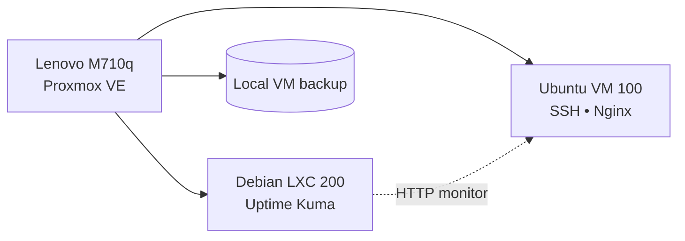
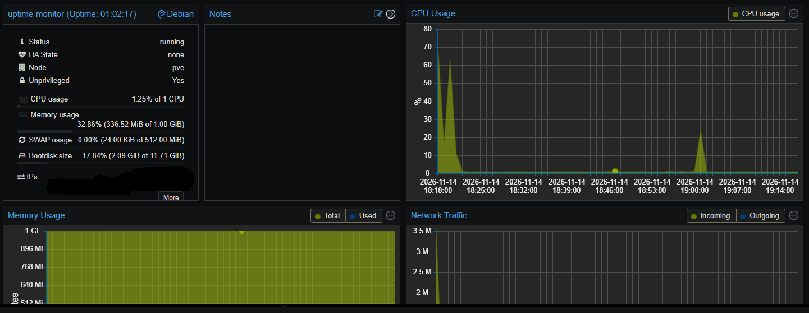
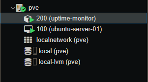
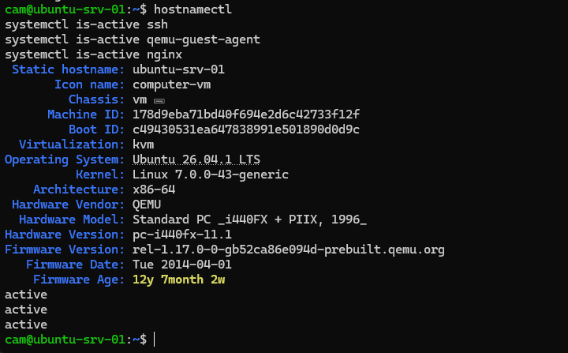
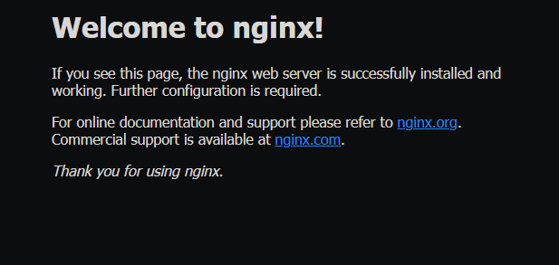
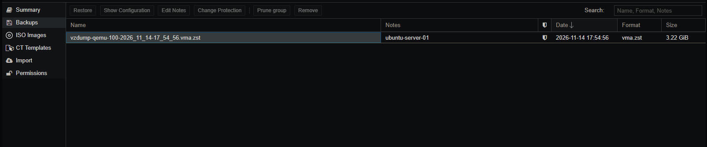
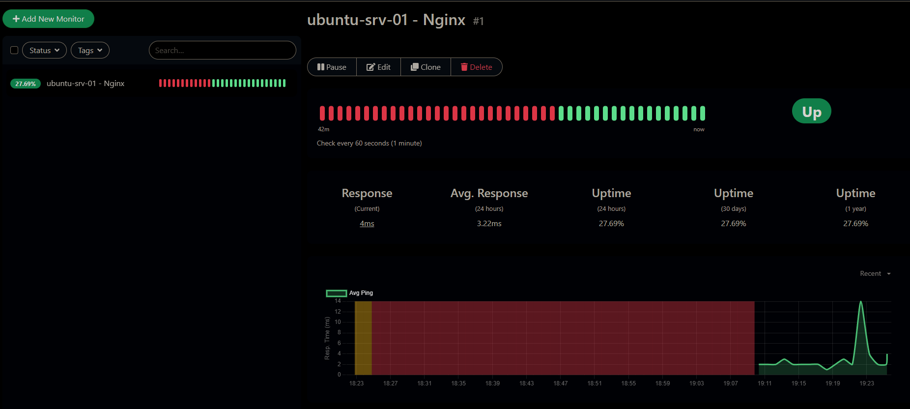

# Cloud & Systems Administration Homelab

> Practical infrastructure administration lab built on a refurbished Lenovo mini PC. **Status: actively developing.** This repository documents work performed, how it was verified, operational issues, and planned improvements.

**Focus:** Linux administration · Virtualization · Networking · Monitoring · Backup & recovery · Cloud operations

## Overview

I built a local virtualization environment to practice the day-to-day responsibilities of systems administrators and cloud operations engineers: deploying Linux workloads, securing remote access, diagnosing connectivity, monitoring services, and restoring virtual machines.

The current environment is **one physical Proxmox node** hosting an Ubuntu Server VM and a Debian LXC monitoring container. A second physical node and cloud integration are future phases, not part of the completed deployment.

## Architecture

[View the architecture diagram and design decisions](architecture/README.md)

## Hardware and virtualization

| Item | Configuration |
| --- | --- |
| Host | Lenovo ThinkCentre M710q Tiny |
| CPU | Intel Core i3-6100T |
| Memory | 8 GB RAM |
| Storage | 256 GB SSD |
| Hypervisor | Proxmox VE 9.2 |
| VM 100 | Ubuntu Server LTS, 2 vCPUs, 2 GiB RAM, 25 GiB disk |
| CT 200 | Debian 13 AMD64 LXC, Uptime Kuma |

## Implemented work

| Area | What was completed | Documentation |
| --- | --- | --- |
| Virtualization | Installed Proxmox, configured repositories and host updates, deployed VM and LXC | [Proxmox installation](docs/proxmox-installation.md) |
| Linux administration | Set up Ubuntu Server, systemd services, SSH key authentication, QEMU Guest Agent and Nginx | [Ubuntu administration](docs/linux-server-setup.md) |
| Networking | Configured host/guest addressing, tested routing and DNS, troubleshot IPv6 and resolver failures | [Networking](docs/networking.md) |
| Backup and recovery | Created a VM backup and restored it into a separate temporary VM; cleaned up test resources | [Backup/recovery](docs/backup-recovery.md) |
| Monitoring | Deployed Uptime Kuma in LXC and verified an HTTP monitor was UP for Nginx | [Monitoring](docs/monitoring.md) |

### Troubleshooting case studies

- [Proxmox package download failures: IPv6, DNS and HTTPS](troubleshooting/ipv6-dns-issues.md)
- [Ubuntu VM "not a bootable disk" after installation](troubleshooting/vm-boot-recovery.md)

These incidents are documented because identifying failure modes and validating fixes are as important as initial deployment.

## Demonstrated checks

- Host web management interface reachable from another machine.
- Ubuntu SSH key login successful.
- Guest static IPv4, internet connectivity, and DNS resolution tested.
- QEMU Guest Agent reported active.
- Nginx welcome page reachable from a browser.
- Backup and restore tasks reported successful; further in-guest recovery evidence is a follow-up.
- Uptime Kuma displayed the Nginx HTTP monitor as UP.

## Evidence

The following screenshots were uploaded from the lab. They illustrate the working infrastructure; supporting implementation and troubleshooting details are in the linked documents above.

### Proxmox host dashboard

### Virtual machine and container inventory

### Ubuntu administration over SSH

### Nginx web server

### Proxmox backup

### Uptime Kuma monitoring

The screenshots show the environment but do not by themselves establish a completed incident-response or in-guest restore validation. Those remain documented separately.

## Next milestones

- [ ] Complete and document a Uptime Kuma DOWN → recovery test
- [ ] Configure and verify notification delivery
- [ ] Validate recovery with a known test file/checksum
- [ ] Store backups on a separate physical device
- [ ] Add the second physical Proxmox node
- [ ] Use Ansible to apply a repeatable Linux configuration
- [ ] Extend exercises into Azure administration (identity, compute, storage, networking, monitoring)
- [ ] Later compare operations in AWS

## Security and limitations

This is a learning environment, not a production deployment. Both the monitor and the monitored web server currently share one physical host, so complete host failure also stops monitoring. The initial backup is on the same SSD as the VM, so it does not protect against physical disk failure. Do not publish credentials, private SSH keys, tokens, internal host inventories, or router configuration exports.

## Why this project

My goal is to build the operational skills needed for cloud administrator, systems administrator, cloud support, and infrastructure roles, with an emphasis on deployment, access, troubleshooting, reliability and recovery rather than application development.
