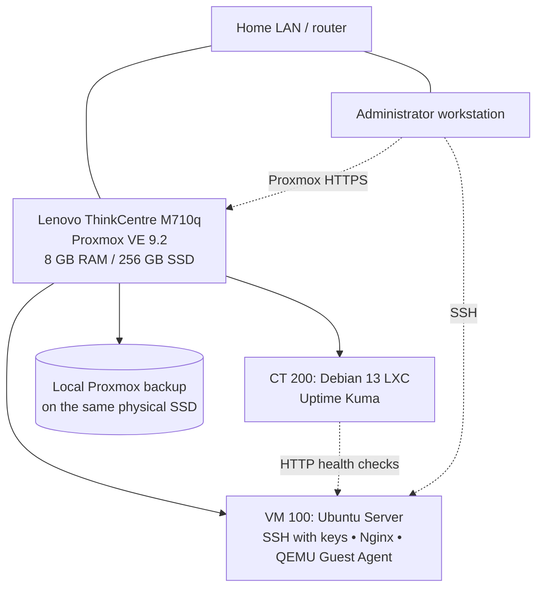

# Lab architecture

This diagram represents the **implemented, single-physical-node** lab, not the eventual two-node design. Address labels are intentionally omitted for public sharing.

## Design choices

- **Proxmox VE** separates the physical server from guest workloads.
- **Ubuntu VM** provides a full Linux guest for system administration, OpenSSH, Nginx, and future Ansible experiments.
- **Debian LXC** runs Uptime Kuma with lower overhead than another full VM.
- **VirtIO networking / vmbr0** lets the guest workloads communicate on the home LAN.
- **Local backups** made the initial recovery exercise possible, but are *not* protection against failure of the sole physical SSD.

## Scope and limitations

Only one physical Proxmox node is operating in this documented deployment. A second physical node, off-host backups, notifications, and automated configuration management are planned work.

## Addressing

The Proxmox host uses a manually managed address; the Ubuntu VM uses an IPv4 address configured through Netplan. The monitor initially used DHCP. Actual LAN addresses and MAC addresses are intentionally excluded from this public document.
